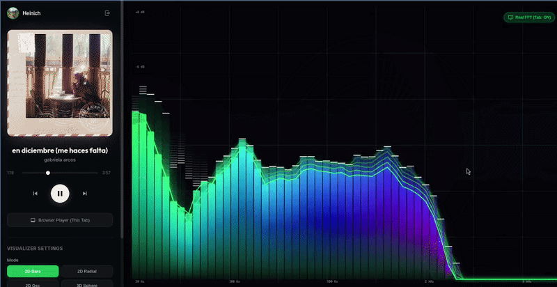

# Spotify Music Visualization



An interactive music visualization application that combines **Spotify integration, Angular, Three.js, and a Java Spring Boot backend** to create a visual experience around music.

**Live demo:** [spotify-music-visualization.onrender.com](https://spotify-music-visualization.onrender.com/)

**Source code:** [GitHub Repository](https://github.com/hporro/spotify-music-visualization)

## Table of Contents

* [Overview](#overview)
* [Features](#features)
* [Technology Stack](#technology-stack)
* [Architecture](#architecture)
* [Getting Started](#getting-started)
* [Running Locally](#running-locally)
* [Docker Deployment](#docker-deployment)
* [Configuration](#configuration)
* [Development](#development)
* [Contributing](#contributing)
* [License](#license)

## Overview

Spotify Music Visualization is a web application designed to explore music through interactive visual representations. It combines a modern Angular frontend with a Java backend, using Three.js for graphics and Spring Boot for server-side functionality.

The project is organized into two main components:

* **Frontend:** An Angular application responsible for the user interface and visual experience.
* **Backend:** A Spring Boot application responsible for server-side operations and Spotify integration.

The application also includes OAuth 2.0 client support and WebSocket capabilities in its backend architecture.

## Features

* **Music visualization:** Interactive graphics powered by Three.js.
* **Spotify integration:** Backend support for Spotify authentication and integration.
* **Interactive web interface:** An Angular-based frontend.
* **Java backend:** RESTful web application capabilities using Spring Boot.
* **Real-time communication infrastructure:** WebSocket support.
* **Containerized deployment:** A multi-stage Docker build for packaging the frontend and backend into a single application.

## Technology Stack

| Technology       | Purpose                                 |
| ---------------- | --------------------------------------- |
| Java 21          | Backend programming language            |
| Spring Boot      | Backend application framework           |
| Spring Security  | Authentication and security             |
| OAuth 2.0 Client | Spotify authentication integration      |
| Spring Data JPA  | Data persistence                        |
| H2 Database      | Embedded database                       |
| Spring WebSocket | Real-time communication support         |
| Angular          | Frontend framework                      |
| TypeScript       | Frontend programming language           |
| Three.js         | 3D graphics and visualization           |
| Node.js and npm  | Frontend build and development          |
| Maven            | Backend dependency management and build |
| Docker           | Containerization and deployment         |

## Architecture

The application follows a frontend/backend architecture.

```text
Spotify Music Visualization
│
├── frontend/
│   ├── Angular application
│   ├── TypeScript
│   └── Three.js visualizations
│
├── backend/
│   ├── Spring Boot application
│   ├── REST API
│   ├── Spring Security and OAuth 2.0
│   ├── WebSocket support
│   └── H2 database integration
│
├── Dockerfile
└── .dockerignore
```

The Docker build compiles the Angular frontend, packages its production assets into the Spring Boot application, and runs the resulting application using a Java runtime.

## Getting Started

### Prerequisites

Install the following tools before running the project locally:

* [Git](https://git-scm.com/)
* [Node.js](https://nodejs.org/) and npm
* [Java Development Kit (JDK) 21](https://adoptium.net/)
* [Apache Maven](https://maven.apache.org/)
* [Docker](https://www.docker.com/) (optional, for containerized execution)

A Spotify Developer account and application credentials may also be required for Spotify authentication.

### Clone the repository

```bash
git clone https://github.com/hporro/spotify-music-visualization.git
cd spotify-music-visualization
```

## Running Locally

The frontend and backend can be developed independently.

### 1. Start the backend

Open a terminal and navigate to the backend directory:

```bash
cd backend
```

Run the Spring Boot application with Maven:

```bash
mvn spring-boot:run
```

The backend's default application port and any required Spotify OAuth settings should be checked in the application configuration before starting the frontend.

### 2. Start the frontend

Open a second terminal from the repository root:

```bash
cd frontend
npm ci
npm start
```

The Angular development server starts using the command configured in the project's npm scripts. By default, Angular's development server uses port `4200`.

Open the local URL printed in the terminal to access the frontend.

> **Note:** Ensure that the frontend is configured to communicate with the correct backend URL and that any required authentication settings are configured before testing Spotify-related functionality.

## Docker Deployment

The repository includes a multi-stage Dockerfile that builds the frontend and backend and packages them into a single runtime image.

### Build the Docker image

Run the following command from the repository root:

```bash
docker build -t spotify-music-visualization .
```

### Run the container

```bash
docker run --rm -p 8080:8080 spotify-music-visualization
```

Once the container has started, open:

http://localhost:8080

The container exposes port `8080`. Any required Spotify credentials and deployment-specific environment variables must be configured according to the application's backend configuration.

## Configuration

Spotify authentication requires the appropriate application credentials and OAuth configuration if the relevant functionality is enabled.

1. Create an application in the [Spotify Developer Dashboard](https://developer.spotify.com/dashboard).
2. Obtain the application's Client ID and, if required by the configured OAuth flow, Client Secret.
3. Configure the credentials in the backend using the application's supported configuration mechanism.
4. Register the correct OAuth redirect URI in the Spotify Developer Dashboard.
5. Ensure the frontend and backend use compatible URLs for local development or production deployment.

**Security recommendations:**

* Never commit Spotify client secrets, access tokens, or refresh tokens to version control.
* Use environment variables or an appropriate secrets manager for sensitive configuration.
* Keep redirect URIs consistent with the configured deployment environment.
* Avoid exposing confidential backend credentials to the Angular frontend.

Refer to the backend configuration files for the exact property names, redirect URI, and required settings.

## Development

### Frontend commands

Run these commands from the `frontend/` directory:

| Command         | Description                            |
| --------------- | -------------------------------------- |
| `npm ci`        | Install dependencies from the lockfile |
| `npm start`     | Start the Angular development server   |
| `npm run build` | Build the frontend                     |
| `npm test`      | Run the configured frontend tests      |

### Backend commands

Run these commands from the `backend/` directory:

| Command               | Description                   |
| --------------------- | ----------------------------- |
| `mvn spring-boot:run` | Run the backend application   |
| `mvn clean package`   | Clean and package the backend |
| `mvn test`            | Run the backend tests         |

## Contributing

Contributions, suggestions, and bug reports are welcome.

1. Fork the repository.

2. Create a feature branch:

   ```bash
   git checkout -b feature/your-feature
   ```

3. Make your changes and test them.

4. Commit your changes:

   ```bash
   git commit -m "Add your feature"
   ```

5. Push your branch and open a pull request.

For larger changes, consider opening an issue first to discuss the proposed implementation.
